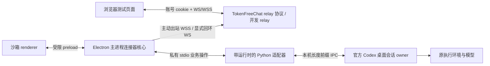

# 架构与安全边界

桌面窗口不拥有网络凭据或 Node 能力。`contextIsolation=true`、`nodeIntegration=false`、`sandbox=true`，CSP 禁止远程资源与 renderer 网络，导航与 window.open 被阻止。主进程仅接受本窗口主 frame 的有限业务动作；没有任意 shell、文件读写、RPC 或 IPC 转发接口。浏览器只有协议白名单业务操作。

本机 Python 进程只属于本项目，stdin EOF 或退出时关闭自己的 IPC。不会启动 Codex CLI、App Server、隧道；不会关闭 Codex 进程。关闭窗口隐藏到菜单栏；停止远程连接与退出独立。single-instance lock 防重复启动；被服务器替换的连接停在 replaced，不互相抢连。

## 身份与授权

- TokenFreeChat 身份、deviceId、随机设备凭据分开。deviceId 是路由标识而非密钥。
- 配对通过随机 pair ID + 8 位码 + 只在连接器内的 256 位 secret。浏览器确认账号后还需本机确认。5 分钟 TTL、5 次失败限制、单次消费；错误尝试另有账号级限速。secret 不放在 URL。
- 长期凭据存 `credential.bin`，由 Electron safeStorage/macOS Keychain 保护。不可用时不退回明文；renderer 和日志拿不到令牌。令牌在 relay 内存中只保留 SHA-256。
- 连接前默认空授权；用户点击连接后授权此电脑全部桌面会话，后续新会话自动纳入，最多 5,000 条目录元数据。最多同时跟随 32 个打开过的会话，达到上限返回 BACKPRESSURE；重新启动连接器可重置订阅。每次操作核验 deviceId、sessionId 和 projectId。relay 校验账号归属和授权副本，连接器再次校验本地范围；撤销时清理缓存并停止转发。读操作结束前再次检查授权代次。
- 撤销立即失效旧令牌并关闭设备/浏览器 WS。断网时解绑保留本机凭据以便重试服务端撤销；服务端已明确拒绝旧凭据时可清理本机并重新绑定。
- 项目是访问分组，不是系统沙箱。远程用户承接被授权原会话的执行权限，不能将其宣传为额外沙箱隔离。
- 本机同一 OS 账号中的恶意进程不在隔离保证内。它原本可以接触内部 IPC、本机凭据或 app 数据；本连接器不是抵御本机账号失陷的防线。

## 网络与状态

生产目标强制 HTTPS/WSS、默认校验证书。只有显式开发选项允许 localhost/127.0.0.1/::1 明文。开发 relay 固定回环监听，严格 Host 和同源 Origin；浏览器用 HttpOnly + SameSite=Strict cookie，TLS 模式加 Secure。浏览器 cookie 不授权 connector endpoint。

设备 socket 15 秒 ping/pong；连接器 45 秒心跳失联终止，relay 连续漏 pong 终止。带抖动指数退避约 0.25–45 秒。401/403 和撤销专用 close code 不当普通断网无尽重试。

网络帧上限 1 MiB，WS 发送缓冲上限 2 MiB，relay 每设备最多 32 个并发请求，浏览器最多 16 个等待请求。状态缓存最多 100 事件 / 4 MiB，保留一个有界历史窗口。慢消费者断开后通过原 owner 快照恢复。核心 journal 最多 10,000 个操作，不静默淘汰导致旧操作再次执行；满后需停止并重新绑定。

mutating 操作首先原子写持久 ledger（ID、payload SHA-256、状态），再发送 IPC。持久化和 IPC 并非分布式事务：异常时返回 uncertain；不会根据 ACK 推断执行完成。崩溃恢复也不重放写入。ledger 文件损坏时拒绝启动，不能静默删记录后重发。浏览器的临时 pending 标记只存 ID/方法/会话 ID，不存聊天正文。

同一会话的普通并发发送拒绝，不队列。发消息前必须是 fresh idle；桌面 owner 仍是最终竞争仲裁者。停止带 expectedTurnId；审批先重新读取 request，再交原 owner 检查。到达 owner 之前已被另一端处理的审批不得自动改成其他请求。未知审批显式要求桌面处理。

## 内容、日志与加密

TLS 保护传输，**不是 E2EE**。中转服务可以看到授权会话内容和完成审批所必需的命令/问题细节。开发 relay 不记录请求体、头、token、聊天正文或工具参数，不持久化聊天。生产 relay 应落实租户隔离、保留期、访问审计与用户告知。

连接器导出日志使用允许列表：时间、稳定错误/生命周期代码、应用/桌面版本、平台、连接布尔状态、授权数量。没有完整会话内容、token、认证文件、请求头、工作路径或工具参数。原始异常不会直接回传用户；Python stderr 被消费但不写日志。普通执行过程只发送工具类别/状态，不发送敏感工具实参；审批界面需要用户判断的内容属于明确授权会话内容，不是诊断日志。

## 当前开发 relay 的边界

`alice`/`bob` 是本地模拟身份，不是真实认证。状态/绑定仅在内存，不能作为生产服务部署。不要把它暴露公网、建立公网隧道或宣传为生产接入。即使以 TLS 启动，它仍固定监听回环。生产身份与服务端持久化是主项目后续工作。
